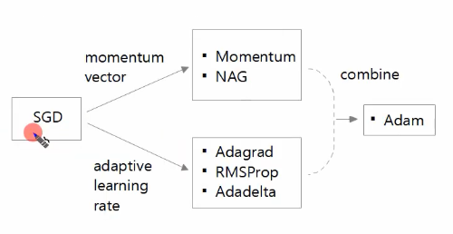
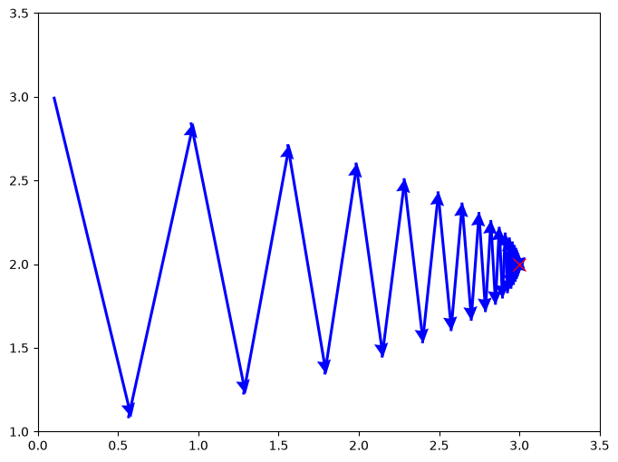
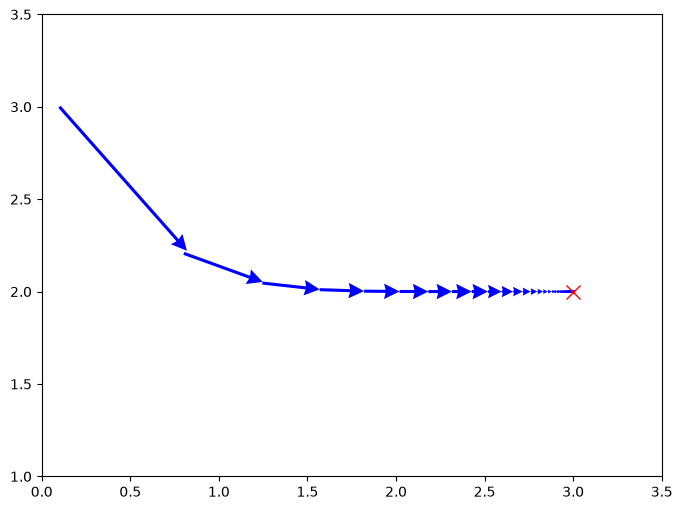
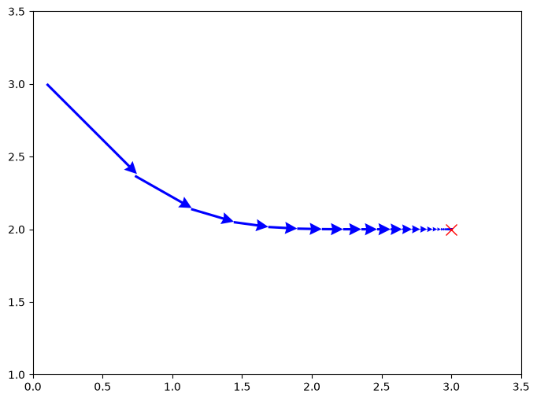
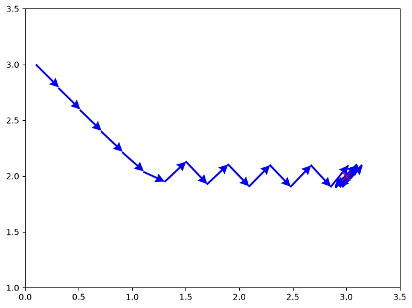
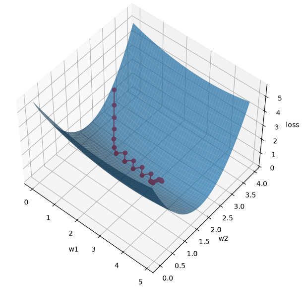

# 2.1 Optimizer

 ## 1.0. SGD optimizer

 

 

 ## 2.0 Momentum optimizer

 

 

 # observation

- the data is set up in a way that W1 has a has a softer slope, and W2 has a steeper slope.
- on running GD optimizer, the Data oscillates between W1 and W2
- on applying momentum optimizer, the momentum from the previous gradient descent will reduce drastic movement on either direction. Hence the oscillating phenomenon is reduced and helps it to converge to the target faster and reliably.

## 3) Adagrad

## 4) RMSprop

### (i) learning_rate = 0.2, rho=0.9

### (i) learning_rate = 0.2, rho=0.1

## 5) Adadelta